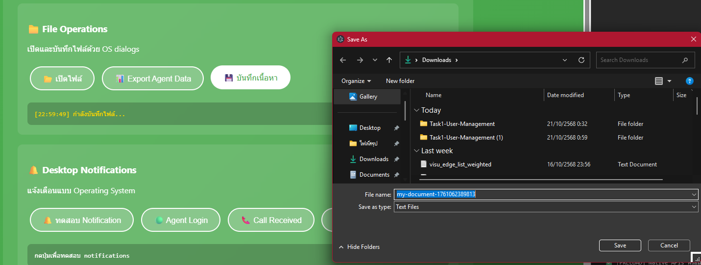
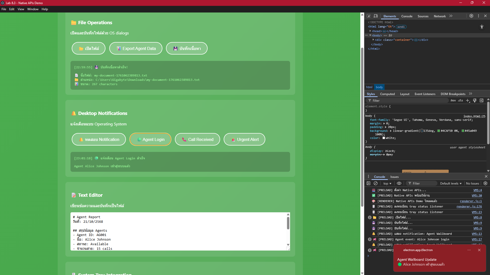
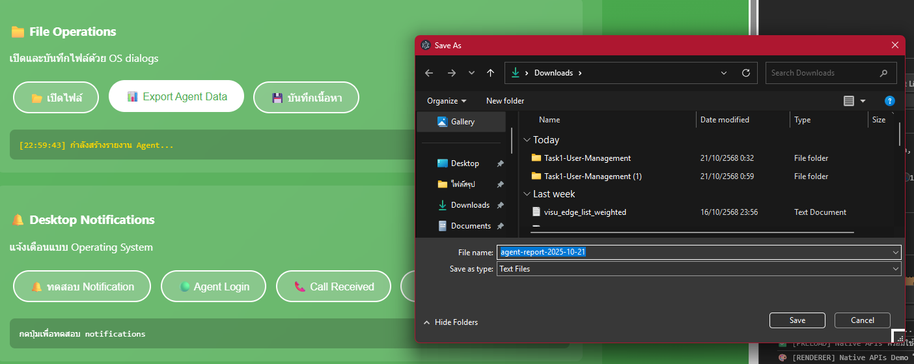

# 🧪 Lab 8.3 – Native APIs Demo (Electron)

## 📘 รายละเอียดงาน
โปรเจกต์นี้เป็น **Lab 8.3 – การใช้งาน Native APIs ของ Electron**  
เพื่อสาธิตการเรียกใช้ฟังก์ชันของระบบปฏิบัติการ (OS) เช่น
- การเปิด/บันทึกไฟล์ด้วย File Dialog  
- การแสดง Desktop Notifications  
- การซ่อน/แสดงแอปผ่าน System Tray  

---

## ⚙️ เทคโนโลยีที่ใช้
- **Electron v38.1.2**
- **Node.js + IPC Renderer/Main**
- **Context Isolation (Preload Bridge)**
- **HTML / CSS / JavaScript**
- **CSP (Content-Security-Policy)** ปลอดภัย ไม่มี inline script

---

## 📂 โครงสร้างไฟล์
```
lab8-3-native-apis/
│
├── main.js               # Main process: dialog, notification, tray menu
├── preload.js            # Bridge สำหรับ expose nativeAPI
├── renderer.js           # Renderer: จัดการ UI และ event
├── index.html            # หน้า UI หลัก
├── package.json          # Config ของโปรเจกต์
├── assets/
│   ├── icon.png
│   └── notification.png
└── README.md
```

---

## 🚀 วิธีรันโปรแกรม
1. ติดตั้ง dependencies
   ```bash
   npm install
   ```
2. เริ่มรันแอป
   ```bash
   npm start
   ```
3. แอปจะเปิดหน้าต่างหลักพร้อม UI ทดสอบ Native APIs

---

## 🧩 ฟีเจอร์หลัก

### 📁 File Operations
- **เปิดไฟล์** → แสดงเนื้อหาใน textarea และ log ผลลัพธ์  
- **Export Agent Data** → สร้างไฟล์ CSV รายงาน agent  
- **บันทึกเนื้อหา** → เขียนข้อความจาก editor ลงไฟล์ `.txt`

📸 **ผลลัพธ์ตัวอย่าง:**




---

### 🔔 Desktop Notifications
สาธิตการแจ้งเตือนผ่าน OS:
- 🔔 **Basic Notification**
- 🟢 **Agent Login**
- 📞 **Call Received**
- 🚨 **Urgent Alert**

📸 **ผลลัพธ์จริง:**



---

### 🖱️ System Tray Integration
- ซ่อนแอปไปยัง tray  
- แสดงเมนูคลิกขวาใน taskbar  
- ทดสอบเปลี่ยนสถานะ agent จาก tray  
- รับ event กลับมาแสดงในหน้า renderer

📸 **ผลลัพธ์:**


---

## ✅ สรุปผลการทดสอบ
| ฟังก์ชัน | สถานะ | รายละเอียด |
|-----------|--------|-------------|
| เปิดไฟล์ | ✅ ผ่าน | เปิด dialog ได้และอ่านเนื้อหาไฟล์ |
| Export CSV | ✅ ผ่าน | สร้างไฟล์ agent-report ได้ |
| Save File | ✅ ผ่าน | เขียนเนื้อหา txt ได้สำเร็จ |
| Notification | ✅ ผ่าน | แสดงบน Desktop OS (Windows) |
| Agent Login | ✅ ผ่าน | แสดงชื่อ agent + เวลา |
| Call Received | ✅ ผ่าน | แสดงสายเข้าพร้อมข้อความ |
| Urgent Alert | ✅ ผ่าน | แจ้งเตือนด่วนพร้อมเสียง |
| Hide to Tray | ✅ ผ่าน | แอปซ่อนไป tray ได้ |
| Tray Event Listener | ✅ ผ่าน | ส่ง event กลับ renderer ได้ |

---

## 🧠 หมายเหตุด้านความปลอดภัย (CSP)
แอปนี้ใช้ **Content Security Policy (CSP)** ดังนี้:
```html
<meta http-equiv="Content-Security-Policy" content="
  default-src 'self';
  script-src 'self';
  style-src 'self' 'unsafe-inline';
  img-src 'self' data:;
  font-src 'self';
  connect-src 'self';
  media-src 'self';
  object-src 'none';
  base-uri 'self';
">
```
ไม่มี inline script หรือ inline event handler เพื่อป้องกันการโจมตี XSS  
ทุกปุ่มผูก event ด้วย `addEventListener()` ภายใน `renderer.js` เท่านั้น

---

## 🖼️ สรุปภาพรวมผลลัพธ์

| ฟีเจอร์ | ตัวอย่างภาพหน้าจอ |
|----------|--------------------|
| File Dialog |  |
| Save Dialog |  |
| Export CSV |  |
| Notification |  |
| Tray Integration |  |

---

## 💬 ผู้จัดทำ
**นาย ธาวัน ทิพคุณ**  
รหัสนักศึกษา: 67543210033-6  
หลักสูตรวิศวกรรมซอฟต์แวร์  
มหาวิทยาลัยเทคโนโลยีราชมงคลล้านนา เชียงใหม่  
ภาคเรียนที่ 1 ปีการศึกษา 2568  

---

> 🎯 *ผลลัพธ์การทำงานทั้งหมดผ่านการทดสอบจริงบน Windows 11 และ Electron 38.1.2*
