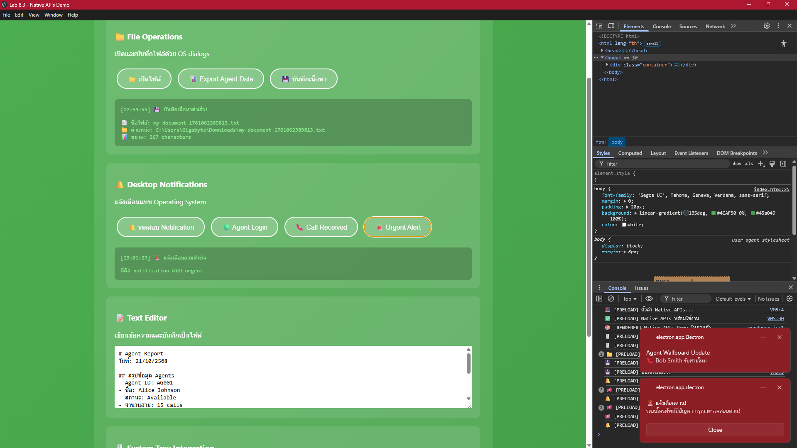
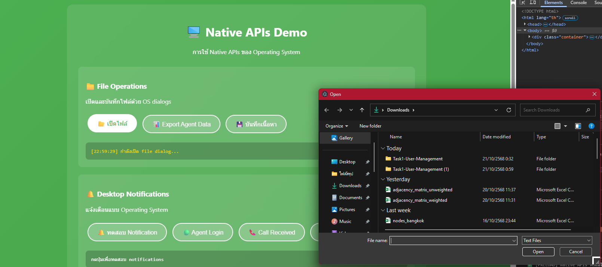
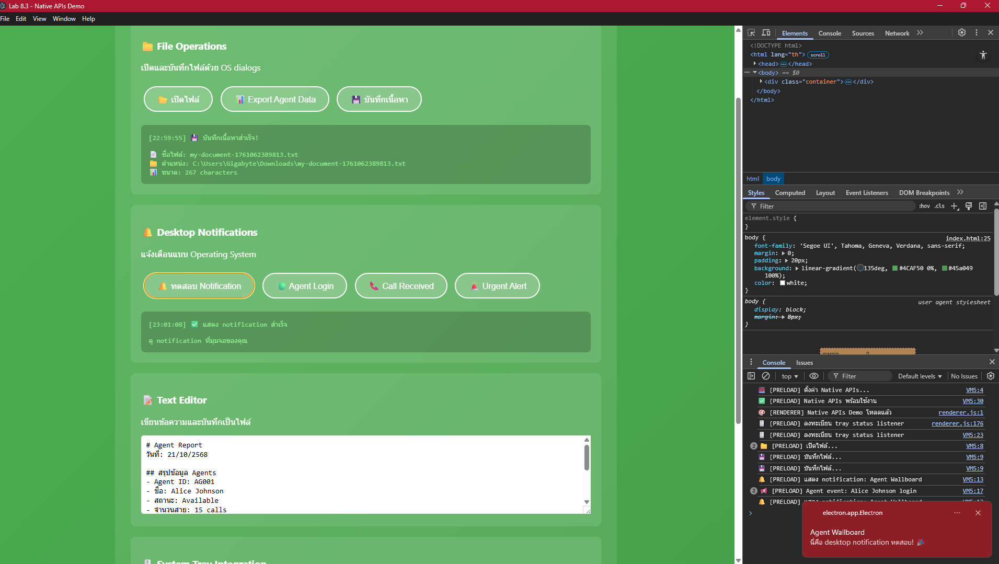
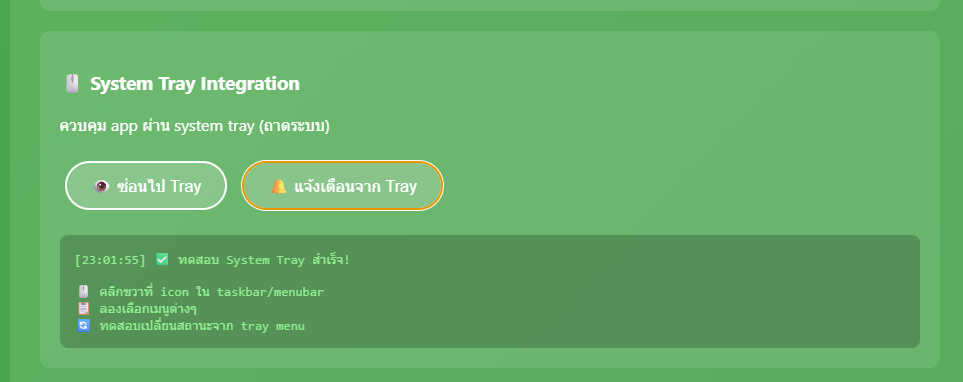

# Electron Native APIs — Files, Notifications & System Tray

**An Agent Wallboard desktop app that integrates with the operating system: native open/save dialogs, CSV export, OS notifications for call-center events, and a system-tray menu that changes agent status while the app is hidden.**


> **ENGSE203, Lab 8.3: Native APIs & System Integration.** Previous: [8.1 First Electron app](https://github.com/tawan230666/Lab-8.1-Electron.js) · [8.2 IPC](https://github.com/tawan230666/Lab-8.2-IPC-Communication).



## Features

| Area | What it does | Electron API |
|---|---|---|
| **Files** | Open a text file, save editor content, export agent data as CSV through native OS dialogs | `dialog.showOpenDialog`, `dialog.showSaveDialog` |
| **Notifications** | Desktop notifications for agent login, incoming calls and urgent alerts (urgent ones stay until dismissed) | `Notification` |
| **System tray** | Tray icon with a menu to show/hide the app and set status (Available / Busy / Break); the UI updates live | `Tray`, `Menu`, `nativeImage` |
| **Hide to tray** | Closing the window keeps the app running in the tray | `BrowserWindow`, `app` |

| Open file | Export CSV | Urgent alert | Tray menu |
|---|---|---|---|
|  |  |  |  |

## Security

- `contextIsolation: true`, `nodeIntegration: false`: the renderer only sees the functions `preload.js` exposes.
- **Strict Content-Security-Policy** (`script-src 'self'`): no inline scripts, so injected markup can't run code. All renderer logic lives in `renderer.js`.
- All file-system access happens in the main process, behind user-confirmed OS dialogs.

## Run

```bash
git clone https://github.com/tawan230666/Lab-8.3-Native-APIs-System-Integration.git
cd Lab-8.3-Native-APIs-System-Integration
npm install
npm start
```

```
main.js       Main process: dialogs, notifications, tray, IPC handlers
preload.js    contextBridge API exposed to the page
renderer.js   UI logic (no inline scripts, CSP-compliant)
index.html    UI with strict CSP
assets/       Tray and notification icons
```

---

**Author:** Tawan Tiphkun (ธาวัน ทิพคุณ), 67543210033-6, [@tawan230666](https://github.com/tawan230666), Software Engineering, RMUTL Chiang Mai
